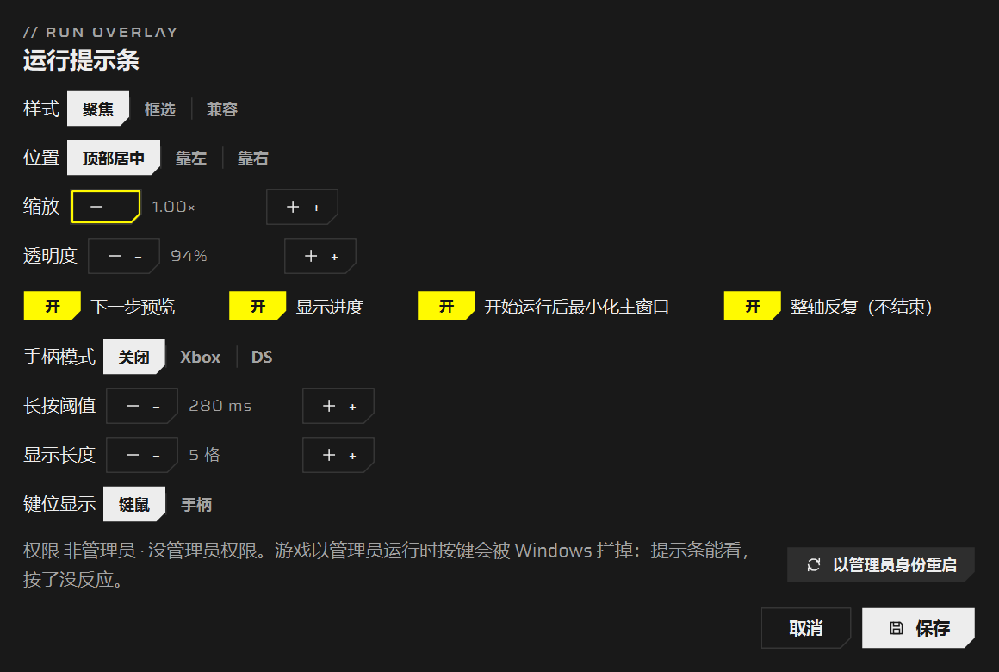
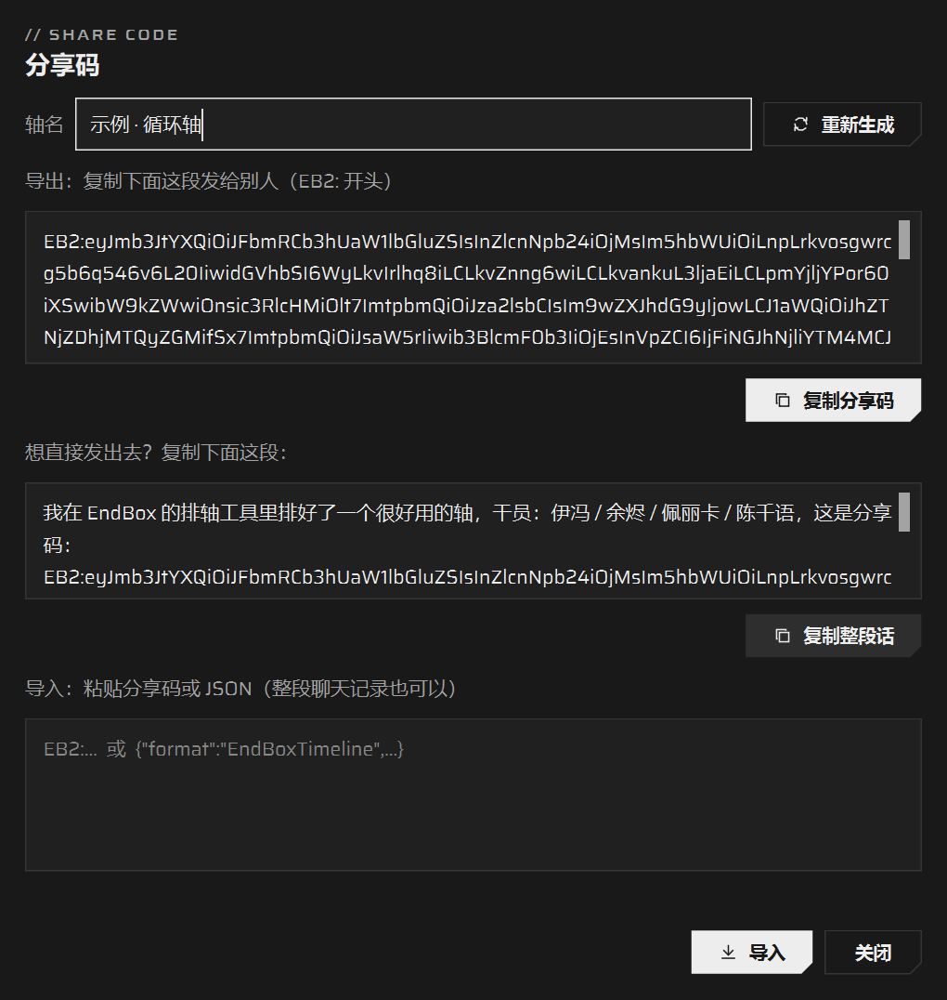
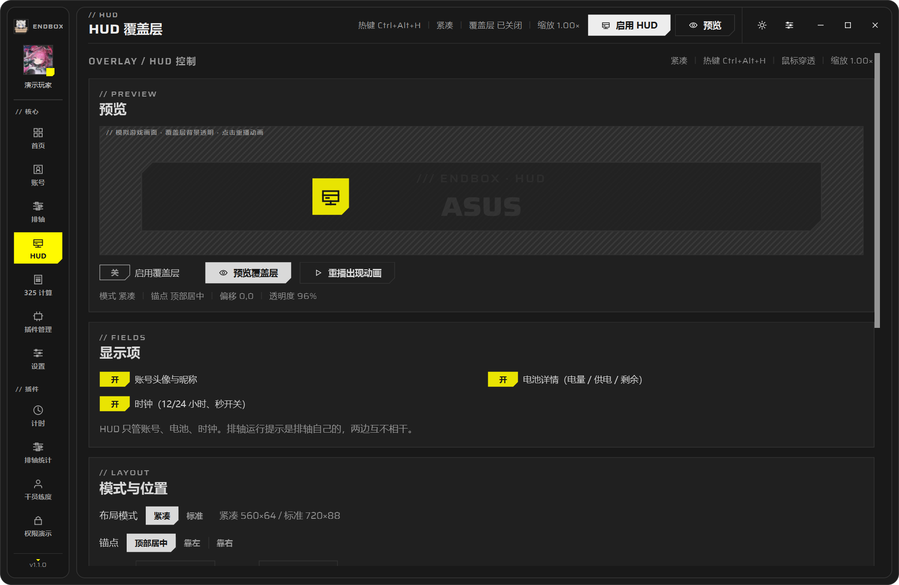
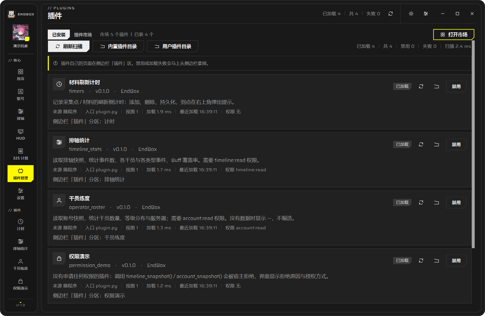
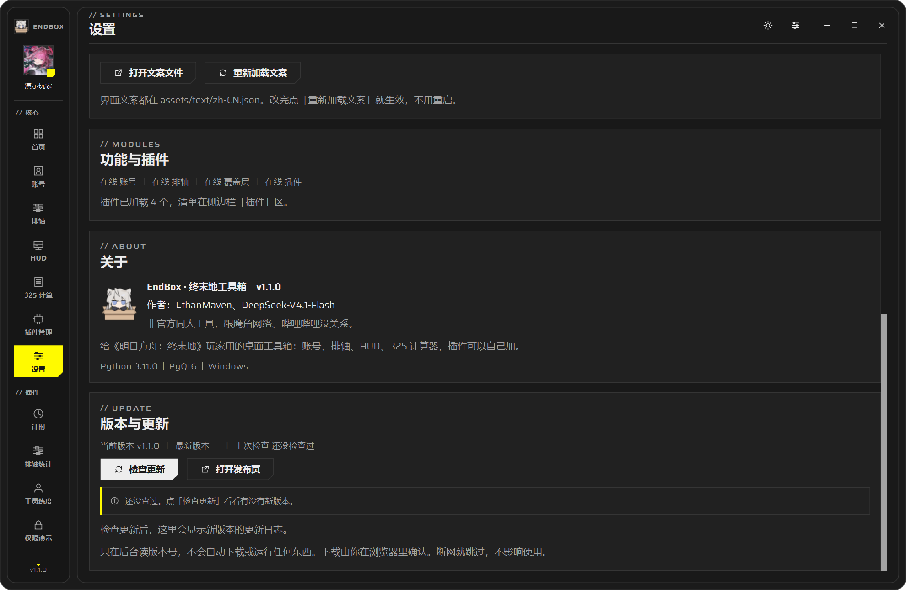

# EndBox · 终末地工具箱

给《明日方舟：终末地》玩家用的 Windows 桌面工具箱。PyQt6 原生开发，终末地工业风界面，便携免安装。

账号资料、技能轴排轴、独立 HUD、325 计算器、插件市场、版本更新——都放在一个窗口里。

作者：**EthanMaven、DeepSeek-V4.1-Flash**。非官方同人工具，与鹰角网络 / 哔哩哔哩无关联。

> 便携模式：数据存在**软件同目录的 `data/`**。旧 `%APPDATA%\EndBox` 的数据首次启动自动迁过来。
> 界面文案都在 [`assets/text/zh-CN.json`](assets/text/zh-CN.json)，改完在设置页点「重新加载文案」就生效。


## 功能

| 模块 | 说明 |
| --- | --- |
| 首页 | 每次打开先回首页，按时段打招呼（早上好 / 下午好 / 夜深了…），显示排轴和账号的当前状态，一键进常用功能 |
| 账号中心 | 森空岛 App 扫码登录官服、B 站扫码登录 B 服。玩家卡（昵称 / UID / 等级 / 服务器）、理智（当前 / 上限 / 满溢倒计时）、规模统计、干员列表（等级 / 突破 / 潜能 / 职业 / 元素，可排序筛选）、地区探索、通行证与每日任务、每日签到 |
| 技能轴 | 4 人编队、有序步骤（战技 / 连携 / 终结 / 切换干员 / 重击 / 注释 / 换行 / 分段 / 反复）、拖拽、撤销重做、编队库与轴库、分享码（导出时附一段可直接粘贴的分享文案，含干员列表与分享码）；干员池来自游戏数据（34 名干员、180 条技能），技能名 / 图标 / 动画时长都是真的，自动估算总耗时与技力消耗 |
| 运行提示条 | 「开始运行」后置顶显示下一步该按什么：**1~4 短按 = 战技，长按 = 终结技，E = 连携，F1~F4 = 切换干员**；按对才前进，按错不动。**默认整轴反复**，跑完自动回开头继续，F8 才退出；卡片显示技能图标（战技/连携/终结/重击）与干员小徽标，显示长度 3~9 格可调，支持透明度与位置调整、F6~F11 运行控制 |
| HUD 覆盖层 | 跟排轴**完全独立**：只显示账号、电池、时钟，标题是 Windows 用户名。鼠标穿透、不抢焦点、不进任务栏，Ctrl+Alt+H 开关，位置 / 缩放 / 透明度可调 |
| 325 计算器 | 求解模式（数字串凑目标，区间 DP + 精确有理数 + 独立复算）与随机模式（L1–L5、种子、积分 / 级数 / 行列式），LaTeX 实时排版；历史 / 收藏 / 导出 PNG |
| 插件与市场 | 插件页分「已安装 / 市场」：分类、搜索、安装、更新、卸载，zip 安全解压 + sha256 校验；官方源随程序分发，也能自己加第三方源。插件能读排轴 / 账号快照，权限没声明会被拒绝 |
| 版本更新 | 设置页「版本与更新」：GitHub Releases 与仓库 `version.json` 双来源检查，能看更新日志、打开发布页、忽略某个版本；顶栏低干扰提示。断网或限流时安静跳过 |

## 运行

```bash
python main.py
```

环境：Windows 10/11、Python 3.11+。依赖 `PyQt6`、`httpx`、`Pillow`；LaTeX 用仓库 `vendor/` 里的 matplotlib，不污染系统环境。

软件同目录的 `data/`：

```
data/settings.json          普通设置
data/secure.dat             本机加密的登录信息（Windows DPAPI）
data/logs/                  运行日志
data/plugins/               自己装的插件
data/timeline.json          当前技能轴
data/timeline_library.json  技能轴库
data/calc325_history.json   325 历史
data/calc325_favorites.json 325 收藏
data/market_state.json      插件市场来源记录
```

程序目录写不了时自动退回 `%APPDATA%\EndBox`；开发/测试可用 `ENDBOX_DATA_DIR` 指定。

## 界面

| 首页 | 技能轴 |
| --- | --- |
|  |  |

| 账号中心（演示数据） | 运行提示条 |
| --- | --- |
|  |  |

| 运行条设置（整轴反复 / 显示长度） | 分享码（附可直接粘贴的文案） |
| --- | --- |
|  |  |

| HUD 控制 | HUD 本体 |
| --- | --- |
|  |  |

| 插件市场 | 已安装插件 |
| --- | --- |
|  |  |

| 版本与更新 |
| --- |
|  |

## 开发

```bash
python -m compileall -q endbox                   # 语法检查
python run_tests.py -q                           # 全部测试（pytest 已 vendor）
python run_tests.py tests/test_timeline.py -q    # 单个模块
python tools/shot.py timeline shots/tl.png dark  # 把一个视图渲染成 PNG
python tools/integration_check.py                # 装配完整应用，跑遍所有视图和深浅主题
python tools/verify_runtime_os.py                # 排轴运行态的按键链路验证
python tools/smoke_exe.py                        # 打包后冒烟：启动 exe，检查服务/插件装配与日志
```

数据与素材：

```bash
python tools/fetch_game_data.py                  # 从数据站抓干员/技能数据，生成 assets/data/*.json
python tools/sync_game_data.py                   # 同步头像与技能图标到 assets/gamedata/（本地缓存，不入库）
python tools/fetch_game_data.py --dry-run        # 只看计划，不落盘
```

开发约定与各模块说明：[`docs/CONTRACT.md`](docs/CONTRACT.md)、[`docs/DESIGN.md`](docs/DESIGN.md)、
[`docs/account.md`](docs/account.md)、[`docs/timeline.md`](docs/timeline.md)、[`docs/hud.md`](docs/hud.md)、
[`docs/calc325.md`](docs/calc325.md)、[`docs/plugins.md`](docs/plugins.md)、[`docs/input.md`](docs/input.md)、
[`docs/update.md`](docs/update.md)。

## 目录结构

```
main.py                  启动入口
endbox/
  app.py                 应用装配：单实例、主题、服务、插件宿主
  version.py             唯一版本源（__version__）
  config.py              路径与设置（便携 data/，ENDBOX_DATA_DIR 可覆盖）
  core/                  日志 / 事件总线 / 加密存储 / 线程 / HTTP / 问候 / 文案 / 提权 / 输入
  theme/                 设计 token、字体、绘制、动效、QSS
  ui/kit/                自绘部件（切角按钮、面板、字段、Toast、确认框、LaTeXView…）
  ui/main_window.py      无边框圆角毛玻璃窗口 + 侧边栏 + 顶栏 + 主显示区
  ui/views/              首页 / 账号 / 技能轴 / HUD / 325 / 插件 / 设置
  modules/               account / timeline / hud / calc325 / update 业务逻辑
  plugins/               插件宿主、API、权限、存储、插件市场
  thirdparty/qrcode/     二维码编码（BSD）
assets/fonts/            Saira 宽体静态字重 + OFL
assets/branding/         透明背景应用图标
assets/data/             游戏数据快照（operators.json / game_meta.json / 干员简介）
assets/text/zh-CN.json   全部界面文案
assets/gamedata/         同步下来的头像与技能图标（本地缓存，不入库）
plugins/                 内置示例插件（timers / timeline_stats / permission_demo / operator_roster）
market/                  官方插件市场索引与打包好的插件包
version.json             最新版本声明（更新检查的兜底源）
素材/                    用户提供的游戏素材（只读）
tools/                   字体/图标生成、数据同步、截图、集成自检、运行态验证
docs/                    开发约定、设计说明、各模块文档
tests/                   测试（文案 key、确认框、集成、输入、运行态、插件市场…）
```

## 打包（v1.1.0）

```bash
python -m PyInstaller --clean --noconfirm EndBox.spec
# 产物：dist/EndBox.exe（单文件）
```

- 首次运行在 **EXE 同目录创建 `EndBox/` 文件夹**，设置、登录信息、日志、轴库、历史都在里面。
- 打包只带 `assets/`、`plugins/`、`market/`；`tests/`、`tools/`、`docs/`、`vendor/` 测试依赖不进包。
- 游戏素材与同步下来的图标因版权和体积**不打包**：把 `素材/` 或 `assets/gamedata/` 放到 EXE 同目录就能被排轴读到，缺了显示占位。
- LaTeX 用的 matplotlib 随包携带；单文件启动会先解压到 `%TEMP%`，第一次开稍慢是正常的。

## 已知限制

- 森空岛与 B 站都是社区第三方接口，没有官方 API；本机没有真实账号，扫码登录和资料拉取的完整链路没做端到端验证，读不到的项目显示「—」，不编造。
- 签到接口是社区整理的，可能失效；失败不影响其他功能。
- 游戏以管理员运行时，EndBox 也要用管理员启动才能读到按键（UIPI），运行设置里有提示。
- HUD 在独占全屏游戏上可能被盖住，请用窗口化 / 无边框。
- 325 历史与收藏最多各 100 条；矩阵 LaTeX 用展开式以适配 mathtext。
- 毛玻璃背景在启动时抓一次整屏，之后随窗口移动实时跟随（不重复截屏，拖动不闪）；换壁纸或桌面内容变了，在设置页点「重新抓一次毛玻璃背景」。
- 仓库还没发过 Release：更新检查会提示「更新地址不存在」，发布后自动生效。
- 插件市场的第三方源由你自己判断可信度；宿主只解压落盘并校验 sha256，不会执行市场里的代码。

## 数据来源与版权

- 干员与技能数据：`data.akedata.wiki`（AKEDatabase 数据站）1.6.4 快照；阵营、简介等事实字段补充自 fz.wiki（CC BY-NC-SA 4.0）。
- 干员头像与技能图标同步到 `assets/gamedata/`，只在本机使用，**不入库、不重新分发**。
- 游戏素材与数据版权归鹰角网络所有；其他第三方组件见 [`THIRD-PARTY-NOTICES.md`](THIRD-PARTY-NOTICES.md)。

## 第三方与许可

- Saira 字体：SIL OFL 1.1；qrcode：BSD；matplotlib：BSD 兼容（vendored）
- 参考项目：Calculate325（MIT，致谢）、EndfieldCharge（MIT）
- 按键模型参考 MaaEnd 项目的游戏键位表，并对照游戏内设置核对
- UI 设计语言参考 endfield-ui 设计规范（夜班变体）；窗口外壳（圆角、独立侧边栏）参考鹰角官方启动器
