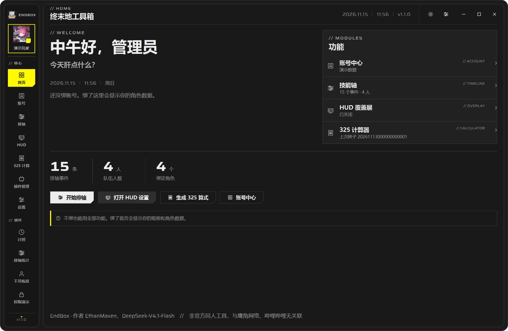
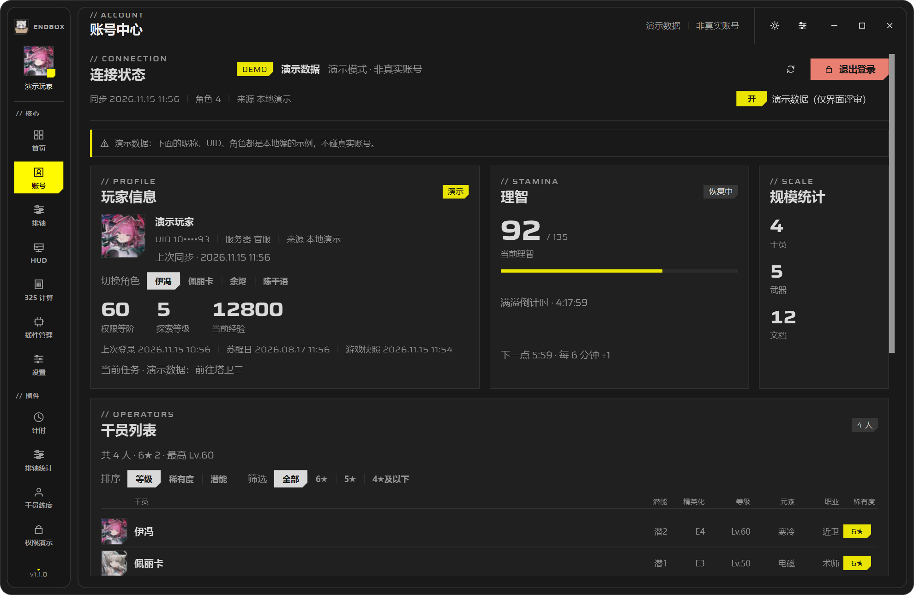
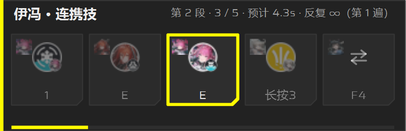
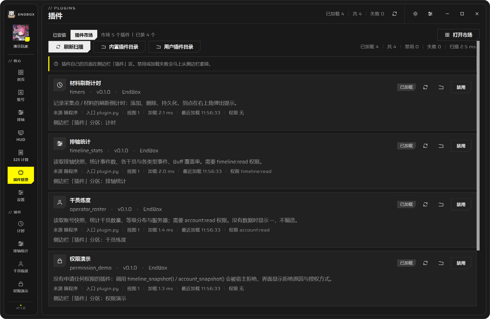

# EndBox · 终末地工具箱

给《明日方舟：终末地》玩家用的 Windows 桌面工具箱。PyQt6 原生开发，终末地工业风界面，便携免安装。

账号资料、技能轴排轴、独立 HUD、325 计算器、插件市场、版本更新——都放在一个窗口里。

[](https://github.com/comreade-123/EndBox/releases)
[](https://github.com/comreade-123/EndBox/releases)
[](LICENSE)



> 开源 · 便携 · 不写注册表。数据和日志都在软件同目录的 `userdata/`，删文件夹即卸载。
> 非官方同人工具，与鹰角网络 / 哔哩哔哩无关联。

## 下载与安装

1. 打开 [Releases](https://github.com/comreade-123/EndBox/releases) 下载 `EndBox-1.1.0-win64.zip`；
2. 解压到任意可写目录（不要放 `C:\Program Files`）；
3. 双击 `EndBox.exe`，首次启动自动创建 `userdata/`。

**关于 Windows 提示「已保护你的电脑」**：这是 SmartScreen 对未购买代码签名证书的程序的常规提醒，不是报毒。
点「更多信息 → 仍要运行」即可；也可以先运行包里的 `1-Start EndBox (first run).bat`（会先解除文件锁定再启动）。

从源码运行需要 Windows 10/11 + Python 3.11：

```bash
pip install PyQt6 httpx Pillow
python main.py
```

## 功能

| 模块 | 能做什么 |
| --- | --- |
| **账号中心** | 森空岛 / B 站扫码登录，玩家卡、理智恢复倒计时、地区探索、通行证与每日任务、帝江号基建、每日签到 |
| **技能轴** | 4 人编队，战技 / 连携 / 终结 / 切换 / 重击 / 注释 / 分段 / 反复排成有序的轴；拖拽、撤销重做、轴库、分享码 |
| **运行提示条** | 置顶显示下一步按什么（真实键位）；按对前进，按错直接跳过并标红，默认整轴反复 |
| **HUD 覆盖层** | 独立于排轴，只显示账号、电池、时钟；鼠标穿透、不抢焦点、`Ctrl+Alt+H` 开关 |
| **325 计算器** | 求解 / 随机出题，精确有理数、LaTeX 实时排版，历史与收藏可导出 |
| **插件市场** | 已安装 / 市场分栏，分类搜索、安装更新卸载，官方源 + 第三方源，sha256 校验 |
| **版本更新** | GitHub Releases 与仓库版本声明双来源检查，更新日志、忽略版本 |

## 使用教程

### 1. 账号

不登录也能用全部功能（账号页显示演示数据并标注）。想显示自己的资料：官服用森空岛 App 扫码，B 服用哔哩哔哩 App 扫码。
登录信息用 Windows DPAPI 加密保存在本机，只有当前用户能解密。

### 2. 排轴

1. 选 4 名干员（顺序即 1–4 号位）；
2. 往轴里加步骤，拖动排序；
3. 顶部实时估算总耗时和技力消耗；
4. 分享会生成一段可直接粘贴的文案（干员列表 + `EB2:` 分享码）。

### 3. 运行提示条

真实键位：**数字短按 = 战技，长按 = 终结技，`E` = 连携，`F1`–`F4` = 切换干员**；重击提示只显示不抢按键。

| 按键 | 作用 |
| --- | --- |
| `F8` | 退出运行 |
| `F9` | 回到第一段 |
| `F10` | 整轴反复开关 |
| `F11` | 回到反复起点 |
| `F6` / `F7` | 提示条变淡 / 变实 |

按对前进；**按错直接跳过这一步**，不弹提示，被跳过的卡片标红并抖一下；到下一步时白色圆圈收缩提示。
游戏以管理员运行时，EndBox 也要管理员启动才能读到按键（Windows UIPI）。

### 4. HUD / 325 / 插件 / 更新

- HUD：`Ctrl+Alt+H` 开关，位置、缩放、透明度在 HUD 页调；独占全屏游戏可能盖住它。
- 325：求解模式凑 325，随机模式出题；历史与收藏各保留最近 100 条。
- 插件：市场安装的插件先解压到临时目录、校验 sha256 再落盘，不执行市场代码；第三方源自行判断可信度。
- 更新：设置 → 版本与更新，能看到更新日志并打开 Releases。

## 界面

| 首页 | 技能轴 |
| --- | --- |
|  |  |

| 账号中心 | 运行提示条 |
| --- | --- |
|  |  |

| HUD | 插件市场 |
| --- | --- |
|  |  |

更多截图见 [shots/](shots/)。

## 数据目录

便携模式下所有可变数据都在软件同目录的 `userdata/`：

```
userdata/settings.json          普通设置（主题、窗口、HUD、运行设置）
userdata/secure.dat             本机加密的登录信息（Windows DPAPI）
userdata/logs/                  运行日志
userdata/timeline.json          当前技能轴
userdata/timeline_library.json  技能轴库
userdata/plugins/               自己装的插件
userdata/calc325_history.json   325 历史
userdata/calc325_favorites.json 325 收藏
```

程序目录写不了时自动退回 `%APPDATA%\EndBox`；旧版本的 `data/` / `EndBox/` 会自动改名迁移。
备份、换电脑，复制整个 `userdata/` 即可。

## 常见问题

- **双击没反应 / 一闪而过**：先看 `userdata/logs/endbox.log` 最后几行；多半是解压不完整或被杀毒软件拦截。
- **提示条按键没反应**：游戏是管理员权限时，EndBox 也要管理员启动。
- **没有毛玻璃**：毛玻璃是系统实时模糊，最大化时关闭；系统不支持时回退纯色，不影响功能。
- **读不到账号数据**：森空岛 / B 站都是社区第三方接口，读不到的项目显示「—」，不编造。

## 开发

```bash
python run_tests.py -q                    # 全部测试
python -m compileall -q endbox            # 语法检查
python tools/integration_check.py         # 装配全部视图跑一遍
python tools/shot.py timeline shots/tl.png dark   # 渲染单个视图
```

打包（文件夹版，避免单文件解包在中文路径失败）：

```bash
python -m PyInstaller --clean --noconfirm EndBox.spec
# 产物：dist/EndBox/EndBox.exe
```

开发约定、模块文档在 [`docs/`](docs/)：`CONTRACT.md`（约定）、`DESIGN.md`（设计）、`timeline.md`、`account.md`、`hud.md`、`calc325.md`、`plugins.md`、`update.md`。

## 项目结构

```
main.py                  启动入口
endbox/                  应用代码
  app.py                 装配：单实例、主题、服务、插件宿主
  config.py              路径与设置（便携 userdata/）
  core/                  日志 / 事件 / 加密 / 文案 / 输入
  theme/                 设计 token、字体、绘制、QSS
  ui/                    窗口、部件库、各模块视图
  modules/               account / timeline / hud / calc325 / update
  plugins/               插件宿主、API、权限、市场
assets/                  字体、图标、文案、游戏数据快照
plugins/                 内置示例插件
market/                  官方插件市场索引与插件包
tools/                   数据同步、截图、集成自检、打包冒烟
docs/                    开发文档与教程
tests/                   自动化测试
```

## 数据来源与版权

- 干员与技能数据：`data.akedata.wiki` 1.6.4 快照；阵营、简介等补充自 fz.wiki（CC BY-NC-SA 4.0）。
- 头像与技能图标只在本机同步使用，**不入库、不随程序分发**。
- 游戏素材与数据版权归鹰角网络所有；第三方组件见 [THIRD-PARTY-NOTICES.md](THIRD-PARTY-NOTICES.md)。

## 许可与致谢

MIT License。

- Saira 字体：SIL OFL 1.1；qrcode：BSD；matplotlib：BSD 兼容（vendored）
- 参考项目：Calculate325（MIT）、EndfieldCharge（MIT）；按键模型参考 MaaEnd 的键位表并对照游戏内设置核对
- 界面设计语言参考 endfield-ui 设计规范；窗口外壳参考鹰角官方启动器

非官方同人工具，与鹰角网络、哔哩哔哩无关联。
