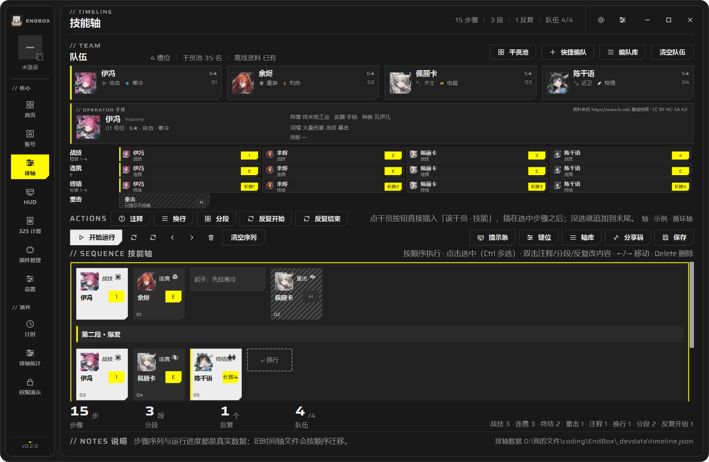
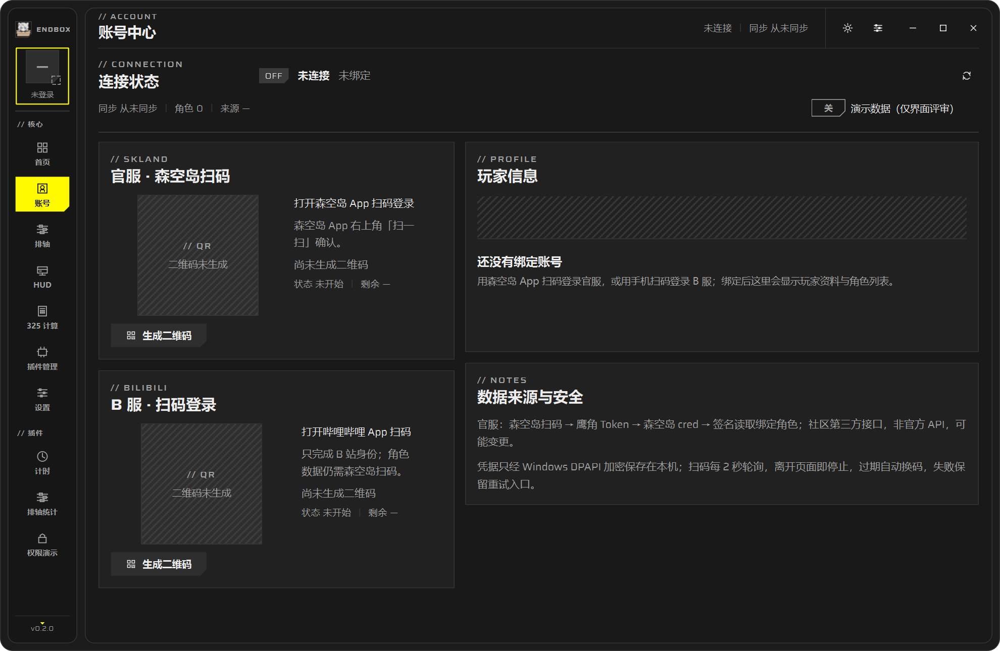
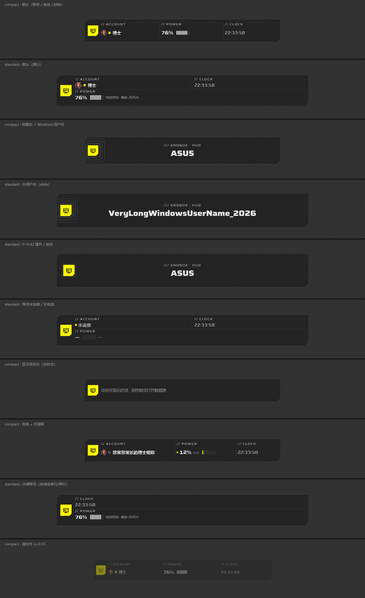
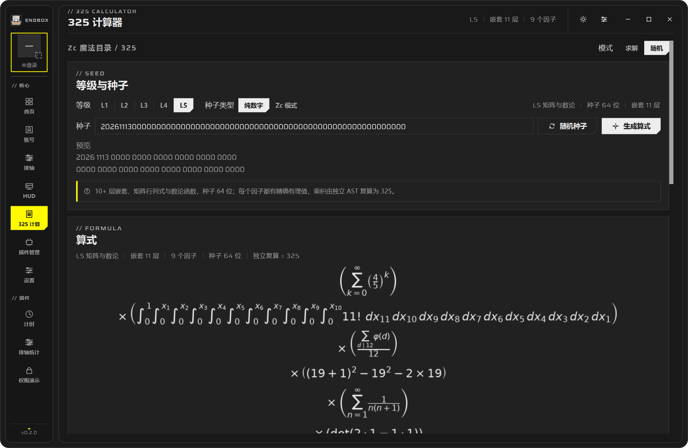
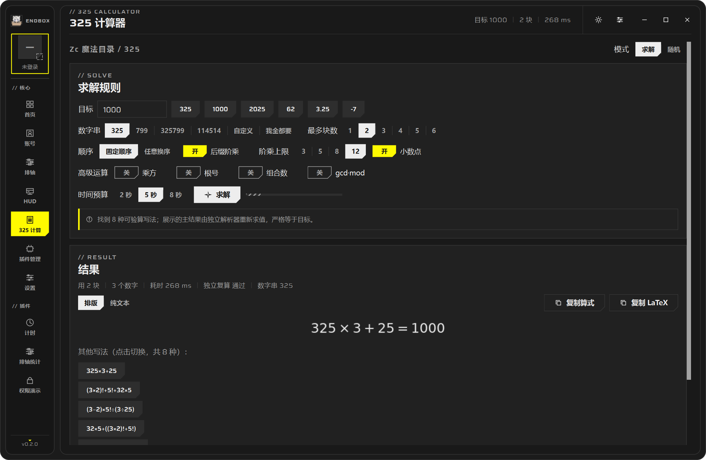
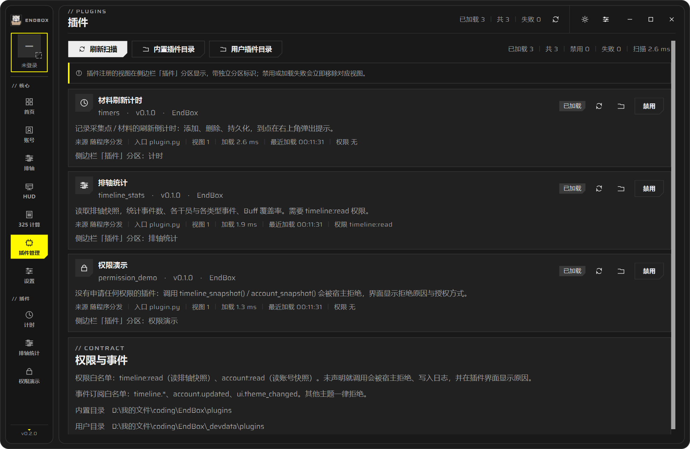
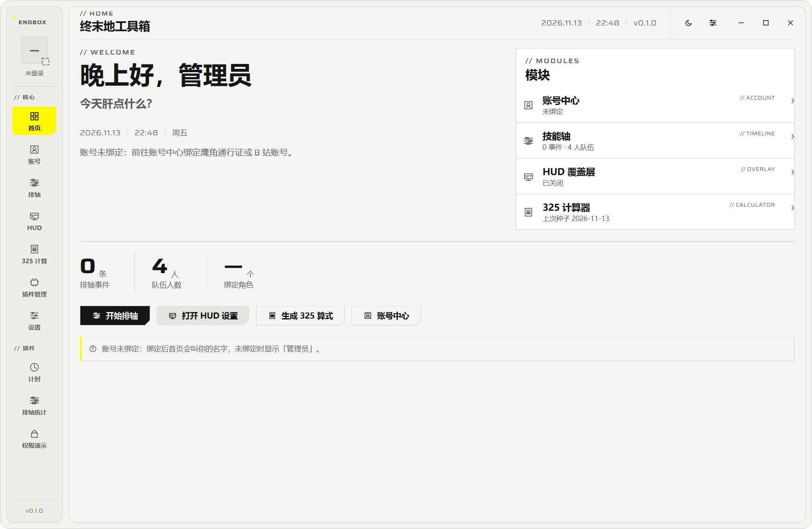

# EndBox · 终末地工具箱

一款面向《明日方舟：终末地》（Arknights: Endfield）玩家的 Windows 桌面工具箱。
基于 **PyQt6** 原生桌面开发，自带终末地工业风界面、每次启动的问候首页、森空岛/B 站扫码账号、
按键提示式排轴、独立 HUD 覆盖层、325 计算器（求解 + LaTeX 随机式）与插件宿主。

作者：**EthanMaven、DeepSeek-V4.1-Flash**。非官方工具，与鹰角网络 / 哔哩哔哩无关联。

> 便携模式：所有数据保存在**软件同目录的 `data/`**；旧 `%APPDATA%\EndBox` 首次启动自动迁移。
> 全部界面文案集中在 [`assets/text/zh-CN.json`](assets/text/zh-CN.json)，改完在设置页点「重新加载文案」。


## 功能

| 模块 | 说明 |
| --- | --- |
| 首页问候 | **每次打开都进入首页**，按时间显示「早上好/上午好/…，EthanMaven/管理员，今天肝点什么？」；点开工具后才记录使用位置 |
| 账号中心 | **森空岛 App 扫码登录** + B 站扫码；玩家昵称/UID/角色列表；凭据 DPAPI 加密保存在软件目录；演示模式明确标注 |
| 技能轴排轴 | 4 人编队、有序步骤序列（战技/连携/终结/重击/注释/换行/分段/反复）、拖拽步骤、撤销重做、键位自定义、编队库/轴库/分享码；干员资料来自 fz.wiki 离线快照 |
| 按键提示运行条 | 「开始运行」后置顶悬浮条显示下一步按键（Q+1~4 / E+1~4 / Alt+1~4 / 长按=终结），**按对才前进、按错不动**；横向步骤卡片（已过变暗/当前高亮/后续预览）、可拖动记忆位置、右键菜单、F6/F7 透明度、F8/F9/F10/F11；管理员/UIPI 提示与一键提权重启 |
| HUD 覆盖层 | 与排轴完全独立：只显示账号 / 电池 / 时钟，标题显示 Windows 用户名；鼠标穿透、不抢焦点、可自定义模式/锚点/偏移/缩放/透明度/时钟格式/多屏/热键录制 |
| 325 计算器 | **求解模式**（数字串凑任意目标，区间 DP + 精确有理数 + 独立复算，示例 325×3+25=1000）与**随机模式**（L1–L5、数字/Zc 种子、复杂积分/级数/行列式），公式用 **LaTeX 实时排版**；历史/收藏/复制 LaTeX/保存 PNG |
| 插件生态 | `plugin.json` + 生命周期 + 视图注册 + 私有存储 + 权限白名单；侧边栏独立「插件」分区；内置 3 个可用示例插件 |

## 运行

```bash
python main.py
```

环境：Windows 10/11、Python 3.11+。依赖：`PyQt6`、`httpx`、`Pillow`；LaTeX 公式渲染使用仓库 `vendor/` 内的 matplotlib（不污染系统环境）。

软件同目录的 `data/`：

```
data/settings.json          普通设置
data/secure.dat             DPAPI 加密凭据
data/logs/                  运行日志
data/plugins/               用户插件
data/timeline.json          当前技能轴
data/timeline_library.json  技能轴库
data/calc325_history.json   325 历史
data/calc325_favorites.json 325 收藏
```

程序目录不可写时自动退回 `%APPDATA%\EndBox`；`ENDBOX_DATA_DIR` 可强制指定（开发/测试）。
全部界面文案：`assets/text/zh-CN.json`；设置 → 数据与凭据里可打开/重新加载。

## 界面

| 首页（问候） | 技能轴（序列编辑） |
| --- | --- |
|  |  |

| 运行条（当前/后续/已过） | 账号中心（森空岛扫码） |
| --- | --- |
|  |  |

| HUD 覆盖层控制 | HUD 本体（标题=用户名） |
| --- | --- |
|  |  |

| 325 随机（LaTeX） | 325 求解 |
| --- | --- |
|  |  |

| 插件管理 | 浅色主题 |
| --- | --- |
|  |  |

## 开发

```bash
python -m compileall -q endbox                 # 语法检查
python run_tests.py -q                         # 全部测试（pytest 已 vendor）
python run_tests.py tests/test_timeline.py -q  # 单个模块
python tools/shot.py timeline shots/tl.png dark  # 视图渲染成 PNG（关毛玻璃，背景稳定）
python tools/integration_check.py              # 装配完整应用、跑遍所有视图与深浅主题
python tools/verify_runtime_os.py              # 排轴运行态按键链路验证（真实按键/自动 fallback）
```

约定与接口： [`docs/CONTRACT.md`](docs/CONTRACT.md)、[`docs/DESIGN.md`](docs/DESIGN.md)、
[`docs/account.md`](docs/account.md)、[`docs/timeline.md`](docs/timeline.md)、[`docs/hud.md`](docs/hud.md)、
[`docs/calc325.md`](docs/calc325.md)、[`docs/plugins.md`](docs/plugins.md)、[`docs/input.md`](docs/input.md)。

## 目录结构

```
main.py                  启动入口
endbox/
  app.py                 应用装配：单实例、主题、服务、插件宿主
  config.py              路径与设置（便携 data/，ENDBOX_DATA_DIR 可覆盖）
  core/                  日志 / 事件总线 / DPAPI / 线程 / HTTP / 问候 / 文案 / 提权 / 输入服务
  theme/                 设计 token、字体、绘制、动效、QSS
  ui/kit/                自绘部件（切角按钮、面板、字段、Toast、确认框、LaTeXView…）
  ui/main_window.py      无边框圆角毛玻璃窗口 + 侧边栏 + 顶栏 + 主显示区
  ui/views/              首页 / 账号 / 技能轴 / HUD / 325 / 插件 / 设置
  modules/               account / timeline / hud / calc325 业务逻辑
  plugins/               插件宿主、API、权限、存储
  thirdparty/qrcode/     二维码编码（BSD）
assets/fonts/            Saira 宽体静态字重 + OFL
assets/branding/         透明背景应用图标（用户提供 icon.png 生成）
assets/data/             干员离线资料快照（fz.wiki 事实字段）
assets/text/zh-CN.json   全部界面文案
plugins/                 内置示例插件（timers / timeline_stats / permission_demo）
素材/                    用户提供的游戏素材（干员立绘、职业、属性图标）
Calculate325-main/       325 功能参考（MIT，独立实现并致谢）
zmd-charge-main/         HUD 动画参考（MIT）
tools/                   字体/图标生成、截图、集成自检、运行态验证
docs/                    开发约定、设计说明、各模块文档
tests/                   测试（含文案 key、确认框、集成、输入、运行态）
```

## 打包

尚未打包。按要求，等界面验视通过后再用 PyInstaller 生成 `.exe`
（需要一并带上 `assets/`、`plugins/`、`vendor/` 里的 matplotlib 与第三方 DLL）。

## 已知限制

- 森空岛扫码接口是社区第三方接口，无官方 API；扫码后 3–6 步（token→grant→cred→绑定列表）无真实账号未端到端验证。
- 游戏以管理员运行时，EndBox 需以管理员启动才能读取按键（UIPI）；运行设置里有提示与一键提权重启。
- HUD 覆盖层在独占全屏游戏上可能被盖住（请使用窗口化/无边框）。
- 325 历史/收藏上限 100 条；矩阵 LaTeX 用展开式以适配 mathtext。
- 毛玻璃背景只在启动时抓取（移动窗口不重抓，避免闪烁），换壁纸后可在设置页手动更新。

## 第三方与许可

- Saira 字体：SIL OFL 1.1；qrcode：BSD；matplotlib：BSD 兼容（vendored）
- 参考项目：Calculate325（MIT，致谢）、EndfieldCharge（MIT）
- 游戏素材、fz.wiki 事实元数据、用户提供的图标：版权归原权利人，详见 [`THIRD-PARTY-NOTICES.md`](THIRD-PARTY-NOTICES.md)
- UI 设计语言参考 endfield-ui 设计规范（变体：夜班）；窗口外壳（圆角、独立侧边栏）按用户要求参考鹰角官方启动器